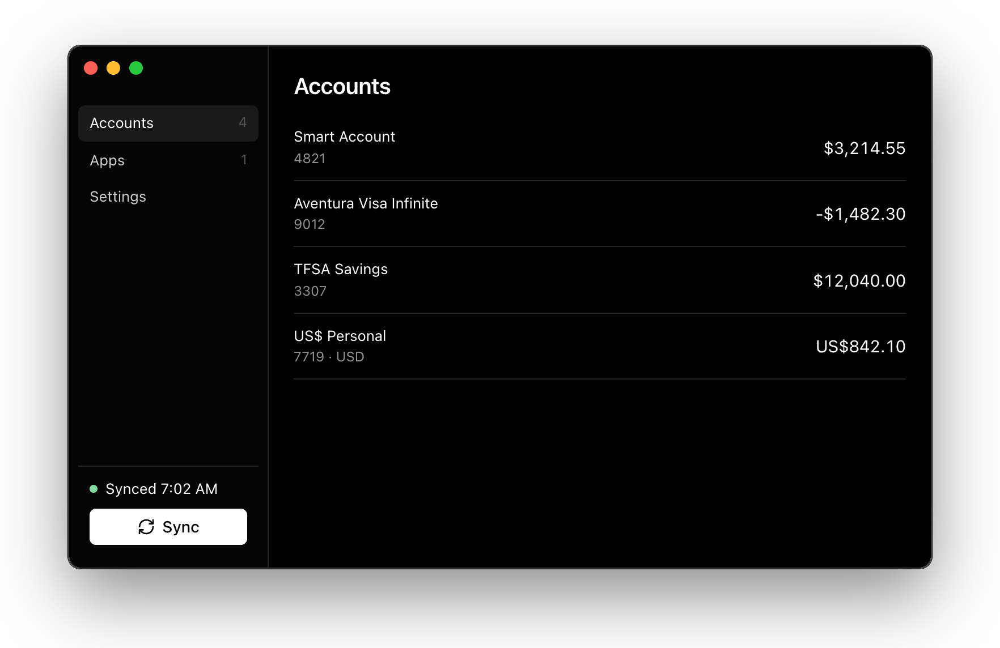
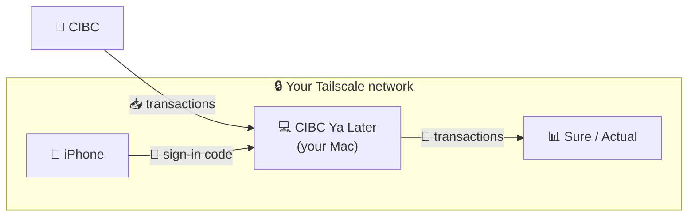

# CIBC Ya Later

Sync your CIBC bank transactions into budgeting apps like [Sure](https://github.com/we-promise/sure) or [Actual Budget](https://actualbudget.org).

Services like Plaid and SimpleFIN Bridge connect your budgeting app to CIBC through a third party, and the connection keeps expiring, so you end up signing in again every few days. CIBC Ya Later runs on your own Mac instead. It signs in to CIBC for you on a schedule, downloads the bank's own transaction exports, and serves them to your budgeting app privately through [Tailscale](https://tailscale.com). No third party ever sees your bank login or your transactions. Your password is kept in the macOS Keychain and only ever sent to CIBC.



## How it works



- **📥 From CIBC:** a background browser downloads CIBC's official export files on the days and time you choose. Nothing is scraped from the page.
- **🔑 Sign-in code:** when CIBC asks for a verification code, an iPhone Shortcut reads it from the CIBC notification and forwards it to the Mac. If it doesn't arrive within 45 seconds, the app asks you to type it.
- **💸 To your budgeting app:** it reads the last download from the Mac and never triggers a bank sign-in.

## Get started

You need:

- An Apple Silicon Mac with Node 24+ and [pnpm](https://pnpm.io)
- Tailscale on the Mac, your iPhone, and the server running Sure or Actual, with [HTTPS certificates](https://tailscale.com/kb/1153/enabling-https) turned on

**1. Build and install**

```sh
git clone https://github.com/louismollick/cibc-ya-later.git
cd cibc-ya-later
pnpm install
pnpm run browser:install
pnpm run package
cp -R "release/mac-arm64/CIBC Ya Later.app" /Applications/
```

**2. Sign in.** Open the app and sign in with your CIBC card number and password. Leave **Download full transaction history** checked to import everything CIBC offers.

**3. Connect your budgeting app.** Go to **Apps → Connect** and copy the token. Then add it in Sure or Actual exactly as you would a SimpleFIN setup token, within 15 minutes.

> CIBC Ya Later isn't SimpleFIN. It speaks the same protocol, so your budgeting app connects to it through its SimpleFIN option.

**4. Forward sign-in codes from your iPhone.** Go to **Settings → Export Shortcut** and AirDrop the file to your iPhone. In the Shortcuts app, add an automation that runs it when a CIBC notification arrives, passing the notification text.

**5. Pick a schedule.** In **Settings**, choose the sync days and time, and turn on **Open at login**.

<details>
<summary><b>6. Lock down access (recommended)</b></summary>

Limit what can reach the Mac in your [Tailscale access policy](https://login.tailscale.com/admin/acls). Only your budgeting server should reach the transactions port (443), and only your iPhone should reach the code port (8443). Use `tailscale ip -4` on each device for the addresses.

```jsonc
{
  "hosts": {
    "cibc-mac": "100.x.x.x",
    "budget-server": "100.x.x.x",
    "iphone": "100.x.x.x",
  },
  "grants": [
    { "src": ["budget-server"], "dst": ["cibc-mac"], "ip": ["tcp:443"] },
    { "src": ["iphone"], "dst": ["cibc-mac"], "ip": ["tcp:8443"] },
  ],
}
```

Remove any broad allow rules that would also cover these ports. The app never turns on Tailscale Funnel.

</details>

## Good to know

- **Data lags by a few days.** CIBC's exports leave out today and the previous two business days, and pending transactions aren't included.
- **Your Mac needs to be awake** for scheduled syncs and for your budgeting app to fetch.
- **Unexpected CIBC challenge?** Sign in once at cibc.com, then click **Sync**.
- **Data location:** `~/Library/Application Support/CIBC Ya Later`. Credentials are in the macOS Keychain.
- **What happened during a sync?** `sync-log.txt` in the data folder records each run's sign-in steps, whether the code came from your iPhone or was typed in, and every request the code relay received. It never contains your password or codes.
- **Keychain prompts after rebuilding?** Builds are signed with your Apple Development certificate if you have one, so "Always Allow" sticks. Without one, every rebuild asks again.

## Development

```sh
pnpm run dev        # run with hot reload
pnpm test           # unit and browser tests
pnpm run check      # lint and format
pnpm run typecheck
```

[MIT](LICENSE). Not affiliated with CIBC. Use at your own risk.
